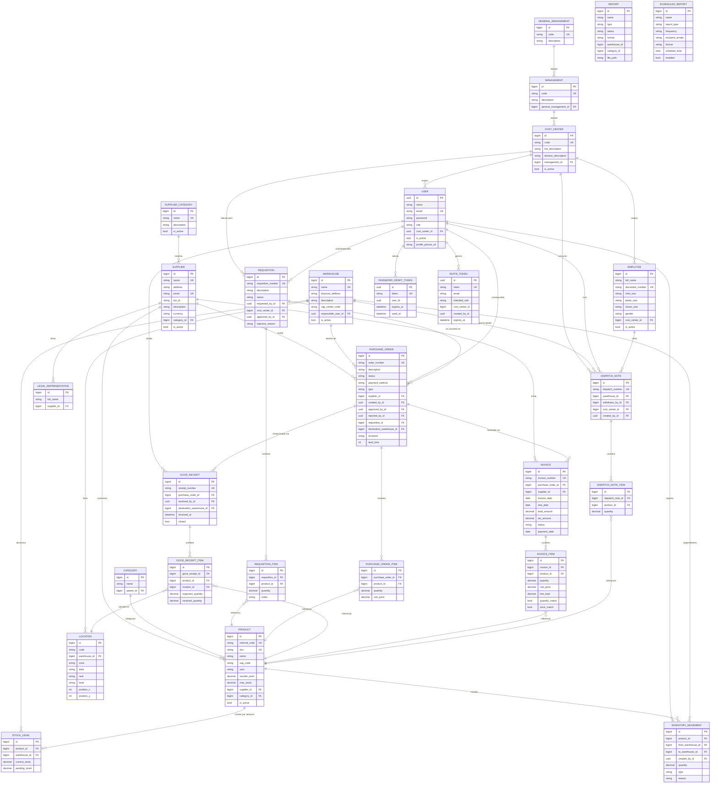

# Visco Orinoco (visco-sg) — Modelo Entidad-Relación (ER)

Diagrama del esquema relacional persistido en PostgreSQL (28 entidades JPA). Las entidades `REPORT` y `SCHEDULED_REPORT` referencian almacenes/categorías por `id` sin FK real, por lo que aparecen aisladas.

