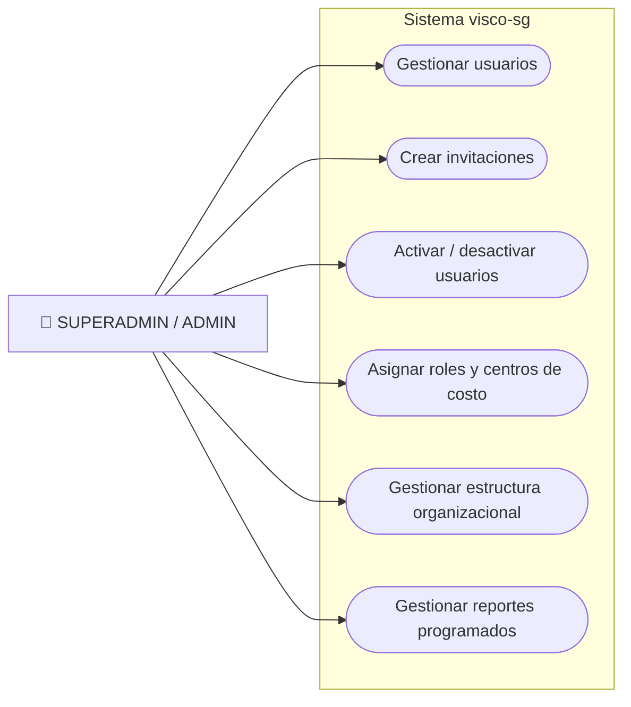
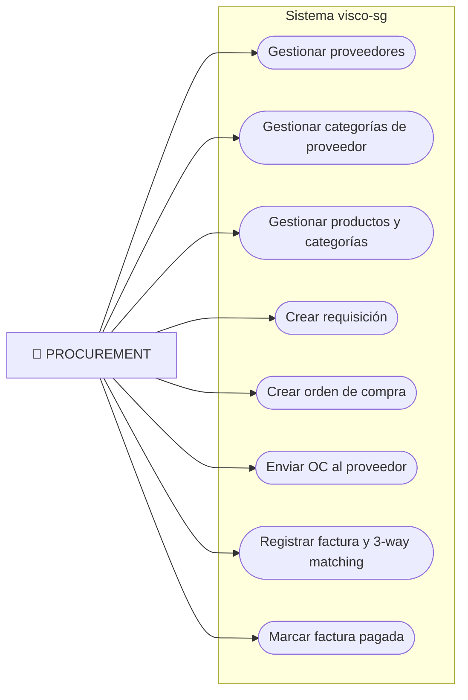
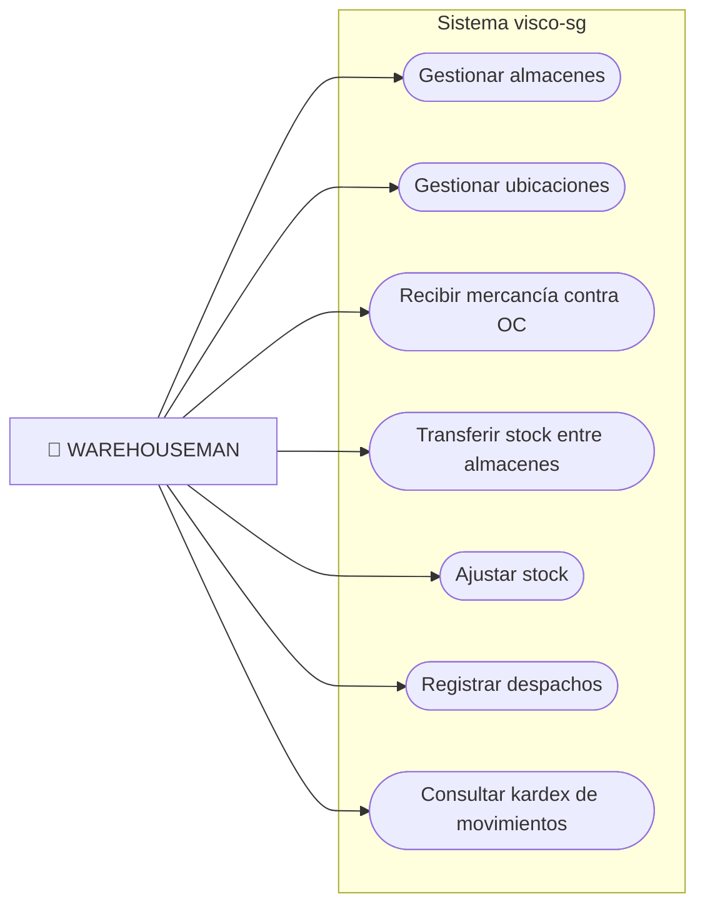
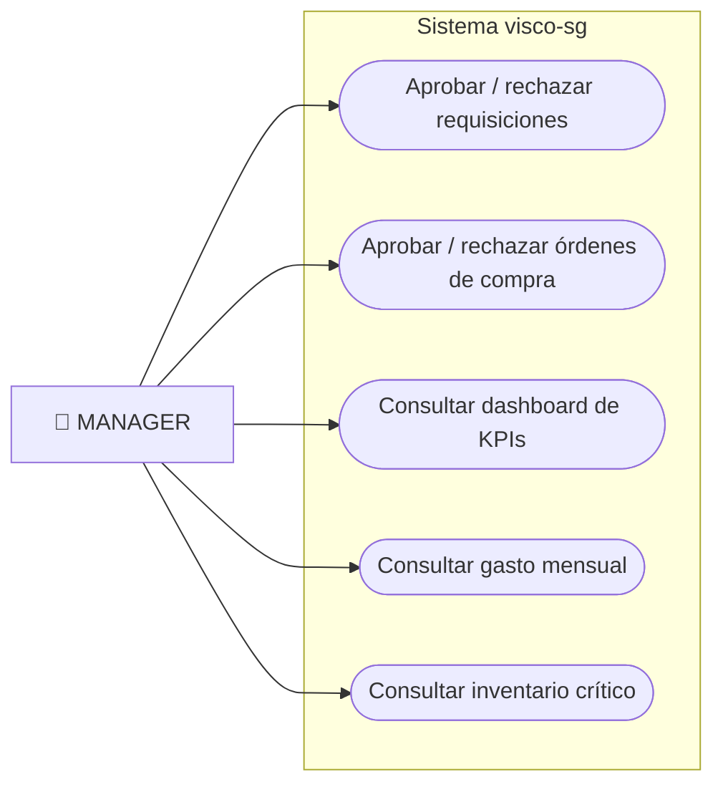
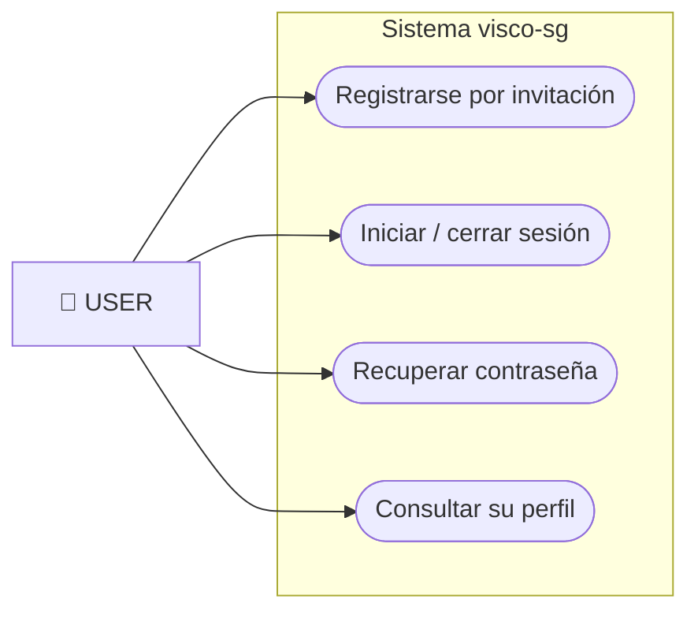
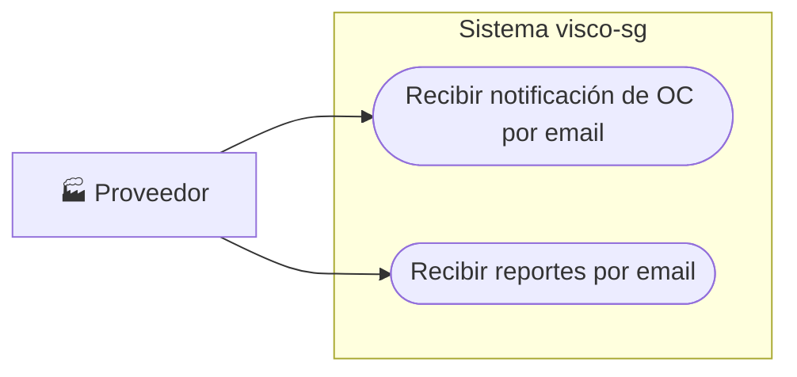

# Visco Orinoco (visco-sg) — Diagramas de Casos de Uso

Diagramas por actor (rol). Los seis roles del sistema son: `SUPERADMIN`, `ADMIN`, `MANAGER`, `PROCUREMENT`, `WAREHOUSEMAN` y `USER`.

## Casos de Uso — Administración (SUPERADMIN / ADMIN)

## Casos de Uso — Compras (PROCUREMENT)

## Casos de Uso — Almacén (WAREHOUSEMAN)

## Casos de Uso — Gerencia (MANAGER)

## Casos de Uso — Usuario básico (USER)

## Casos de Uso — Actor externo (Proveedor)

## Relación actores → roles

| Actor | Rol del sistema | Módulos |
|-------|-----------------|---------|
| Administrador | `SUPERADMIN` / `ADMIN` | Usuarios, invitaciones, organización, reportes |
| Compras | `PROCUREMENT` | Proveedores, productos, requisiciones, OC, facturas |
| Almacenista | `WAREHOUSEMAN` | Almacenes, ubicaciones, recepciones, transferencias, despachos |
| Gerente | `MANAGER` | Aprobaciones, dashboard, gastos |
| Usuario | `USER` | Autenticación y perfil |
| Proveedor | Externo (fuera del sistema) | Recibe notificaciones por email |
