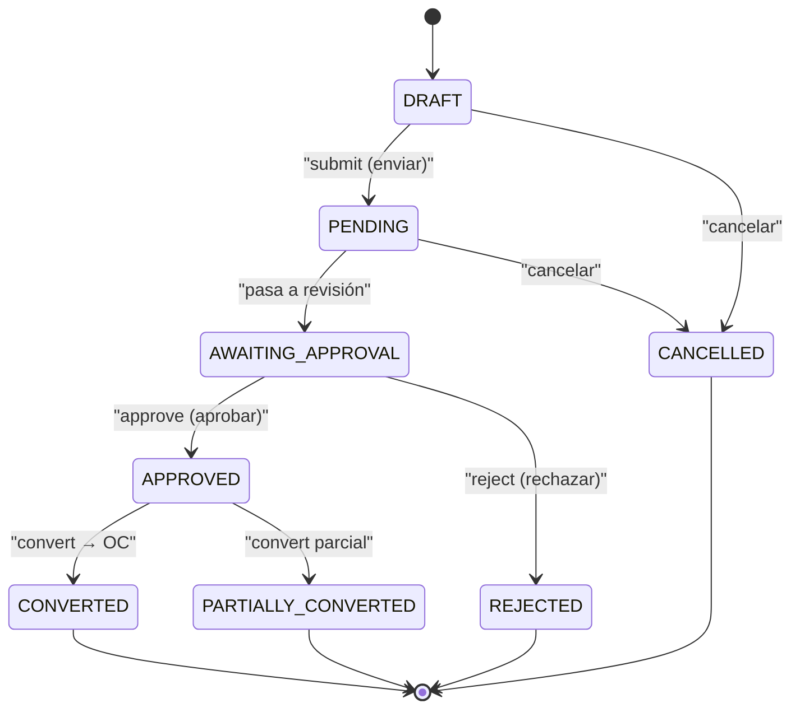
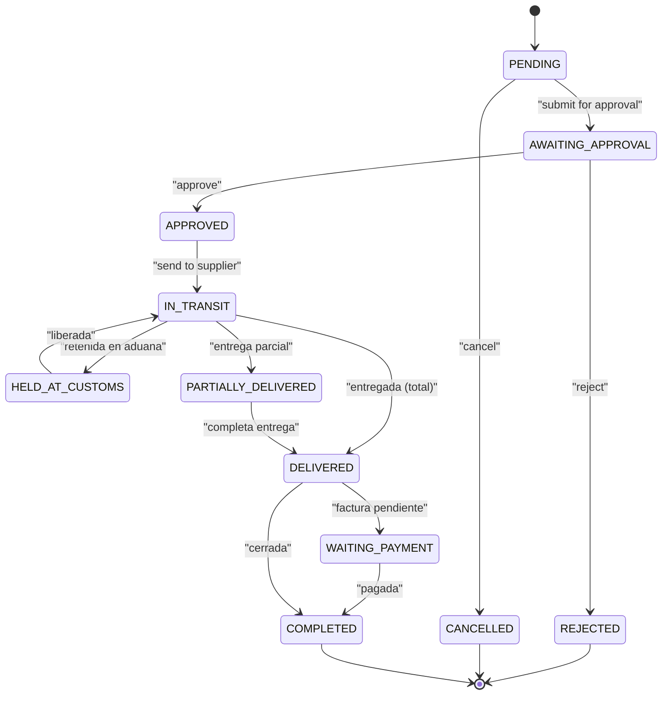
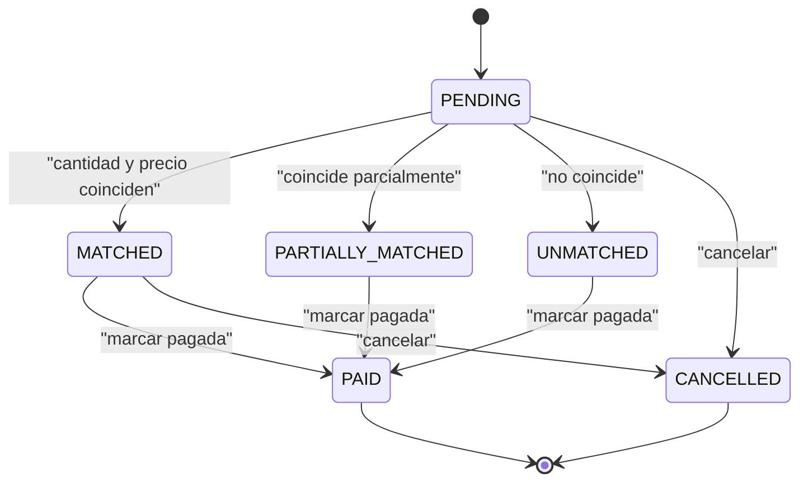
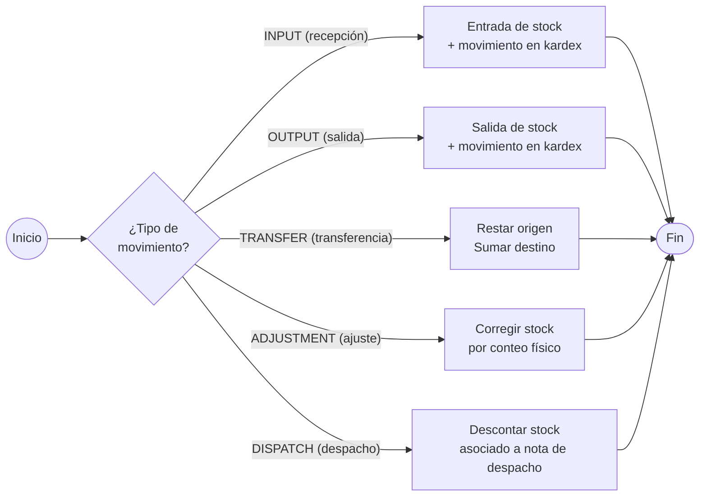
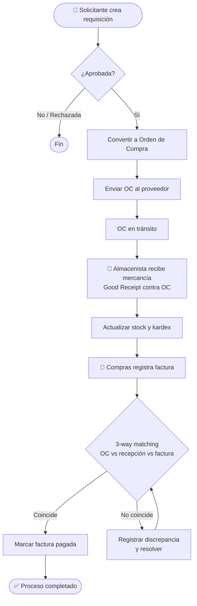

# Visco Orinoco (visco-sg) — Diagramas de Flujo de Trabajo (Workflows)

## Ciclo de vida — Requisición de Compra

## Ciclo de vida — Orden de Compra

## Ciclo de vida — Factura (3-way matching)

## Tipos de movimiento de inventario

## Flujo integral Procure-to-Pay

